# Deploy a web application in K8s cluster from private Docker registry

## Overview

This project demonstrates how to deploy a containerized web application to a Kubernetes cluster hosted on Linode Kubernetes Engine (LKE) using a container image stored in a private Amazon Elastic Container Registry (Amazon ECR) repository.

The deployment process includes creating Kubernetes image pull secrets, configuring the deployment to authenticate with a private registry, and deploying the application into the cluster.


## Technologies used
* Linode Kubernetes Engine (LKE)
* Amazon Web Services (AWS)
* Amazon Elastic Container Registry (ECR)
* Docker
* kubectl

## Project Description:

In this project, you will learn how to:

* Create a Kubernetes secret for authenticating to a private Docker registry.
* Configure a Kubernetes deployment to use the registry secret.
* Deploy a container image stored in a private Amazon ECR repository.
* Verify that the application is successfully running within the Kubernetes cluster.

## Architecture

Amazon ECR (Private Repository)
            │
            │ Image Pull
            ▼
 Kubernetes Secret
 (Docker Registry Credentials)
            │
            ▼
 Linode Kubernetes Engine (LKE)
            │
            ▼
 Application Deployment
            │
            ▼
        Running Pods

## Pre-requisites

Before starting, ensure you have:

* An AWS account with access to Amazon ECR
* A Linode account
* AWS CLI installed and configured
* Docker installed
* kubectl installed
* Permissions to create Kubernetes resources within the cluster

Verify the required tools:

```
    aws --version
    docker --version
    kubectl version --client
```

## Steps

### 1. Create a Linode Kubernetes Engine (LKE) Cluster
 
Create a new Kubernetes cluster using Linode Kubernetes Engine (LKE).
 
During cluster creation:
 
- Select the desired Kubernetes version.
- Choose a data center region.
- Configure the worker node pool size and instance type.
- Review the configuration and create the cluster.


In this project, the Kubernetes control plane is fully managed by Linode, allowing us to focus on deploying and managing applications.
 
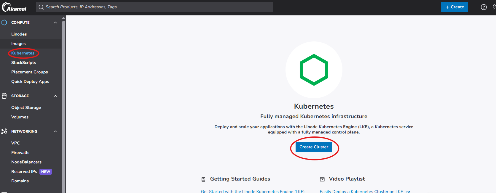
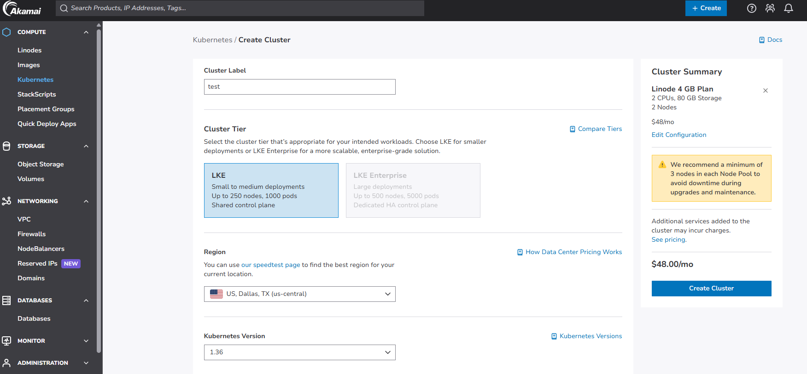
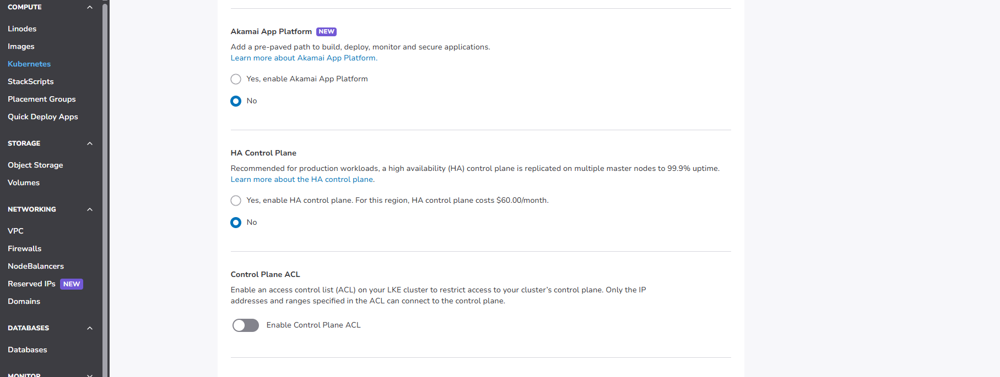
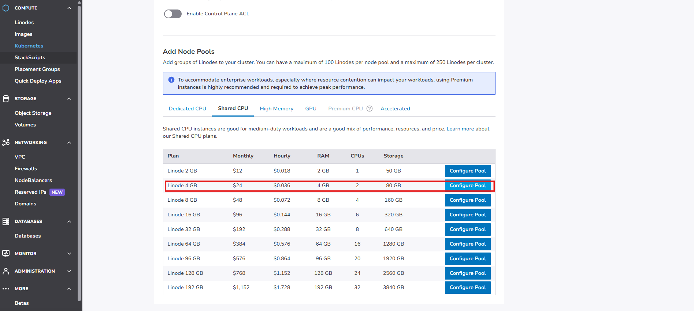
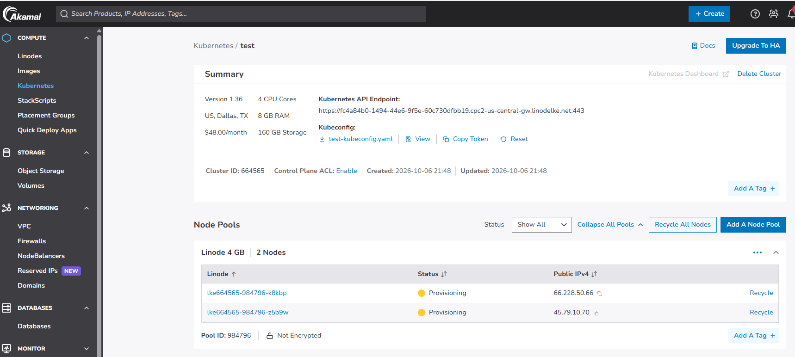


### 2. Wait for the Cluster to Become Available
 
After provisioning begins, wait for the cluster status to change to **Running**.


The Kubernetes worker nodes must be fully initialized before applications can be deployed.


Verify the cluster status in the Linode Cloud Manager.


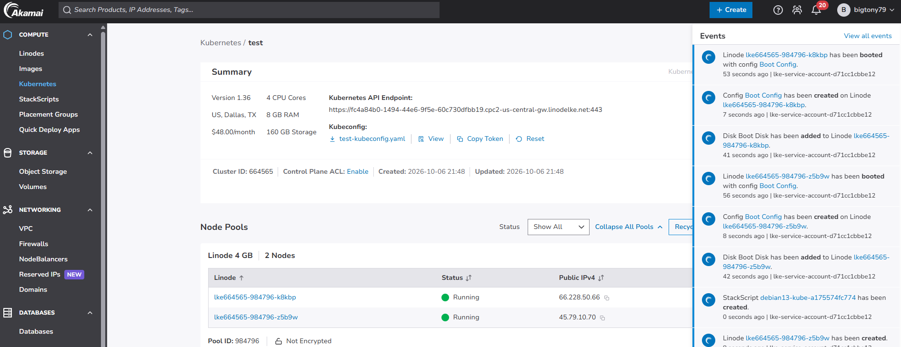


### 3. Download the Kubeconfig File
 
Once the cluster is ready, download the cluster's **kubeconfig** file from the LKE portal.
 
The kubeconfig file contains:
 
- Cluster endpoint information
- Authentication credentials
- Context configuration used by kubectl


Save the file locally.


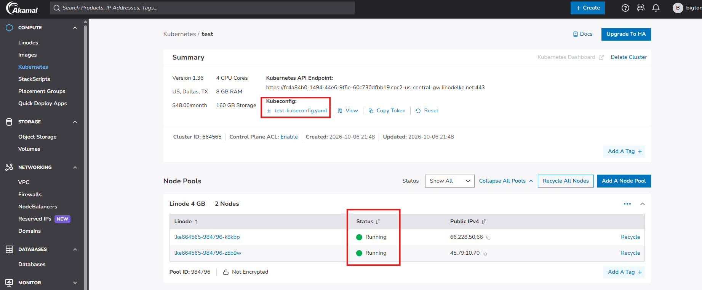


### 4. Configure kubectl to Connect to the LKE Cluster
 
Before configuring the kubeconfig file, verify whether kubectl is currently connected to a cluster.
 
```bash
kubectl get nodes
```
 
If no cluster is configured, an error similar to the following may be displayed:
 
```text
The connection to the server localhost:8080 was refused
```
 
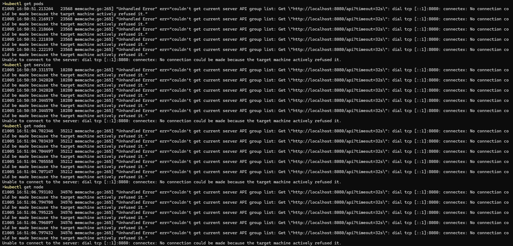


Configure kubectl to use the downloaded kubeconfig file:
 
```bash
export KUBECONFIG=test-kubeconfig.yaml
```
 
Verify connectivity:
 
```bash
kubectl get nodes
```


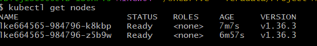


### 5. Retrieve the Docker Login Command from Amazon ECR

Sign in to the AWS Management Console and navigate to Elastic Container Registry (ECR).

Select your private repository and locate the View Push Commands option. Copy the Docker authentication command provided by AWS.

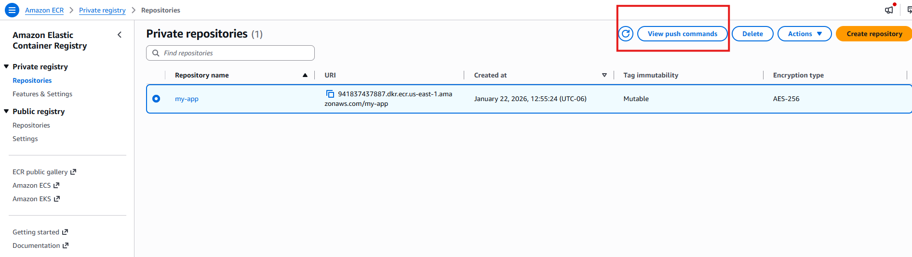
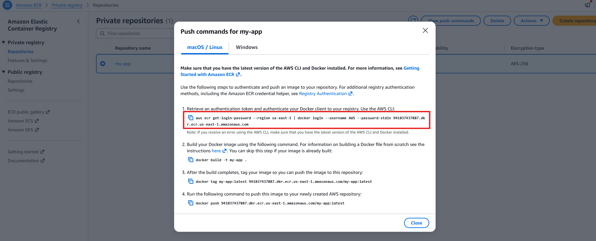

### 6. Authenticate Docker with Amazon ECR

Run the ECR login command to authenticate Docker and generate the local Docker configuration file (~/.docker/config.json).

```
    aws ecr get-login-password --region us-east-1 | docker login --username AWS --password-stdin 941837437887.dkr.ecr.us-east-1.amazonaws.com
```

### 7. Create a Kubernetes Docker Registry Secret

Create a Kubernetes secret using the Docker configuration file generated in the previous step.

```
    kubectl create secret generic docker-secret-key --from-file=.dockerconfigjson=/home/dataeng/.docker/config.json --type=kubernetes.io/dockerconfigjson
    kubectl get secrets
```

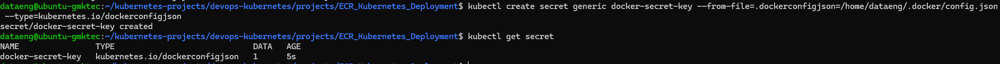

### 8. Deploy the Application

Update your deployment manifest to:
* Use the full Amazon ECR image URL.
* Reference the Kubernetes image pull secret using imagePullSecrets.

Example:
```
    imagePullSecrets:
        - name: docker-secret-key
```

Deploy the application:
```
    kubectl apply -f app-deployment.yaml
```

Verify the deployment:
```
    kubectl get deployments
    kubectl get pods
```

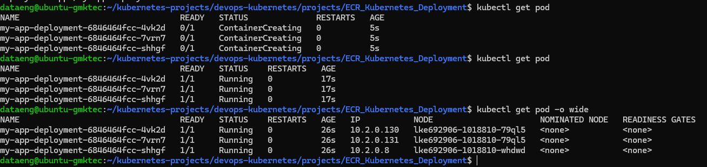

## Learning Outcomes
By completing this project, you will gain hands-on experience with:

* Kubernetes deployments
* Private container registries
* Amazon ECR authentication
* Kubernetes Secrets
* ImagePullSecrets configuration
* kubectl administration
* Deploying applications on Linode Kubernetes Engine (LKE)
* Managing containerized workloads across cloud platforms


