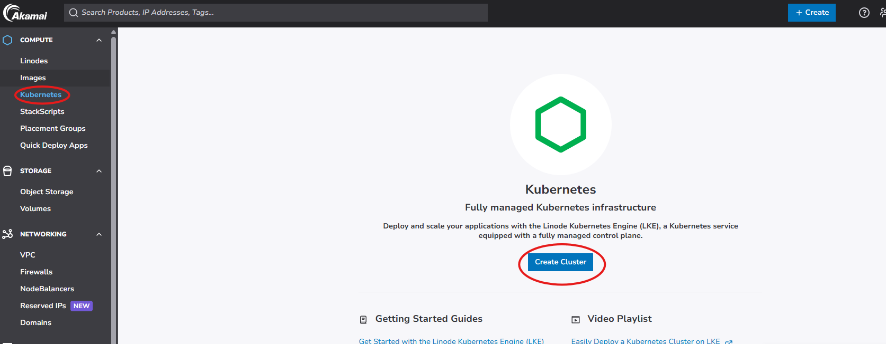
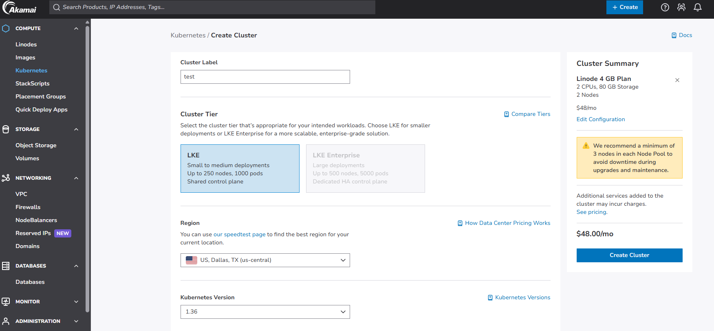
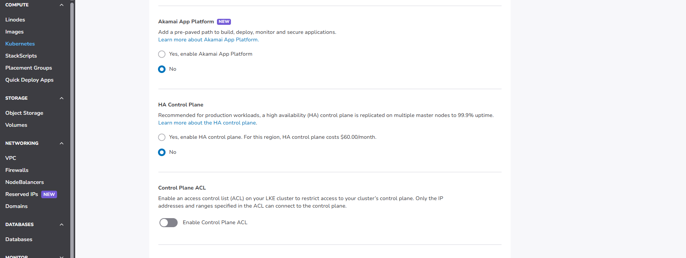
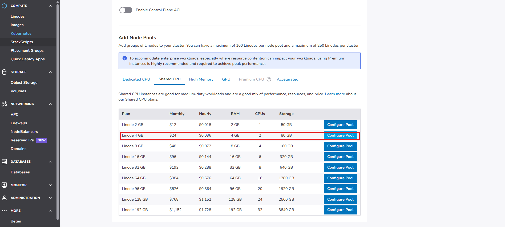
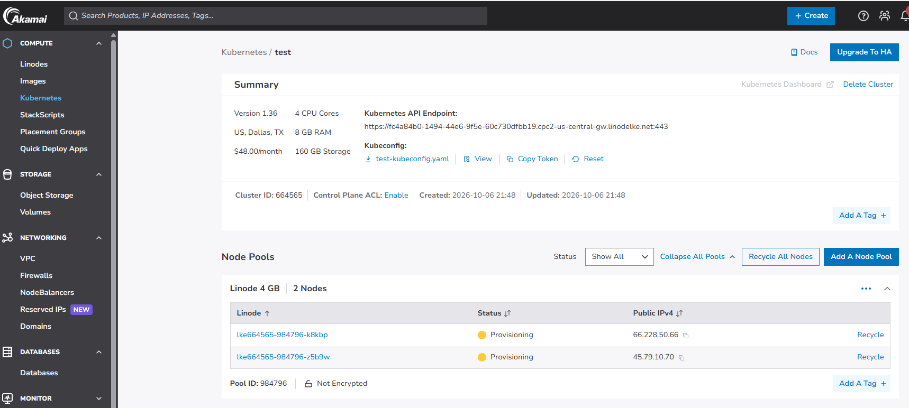
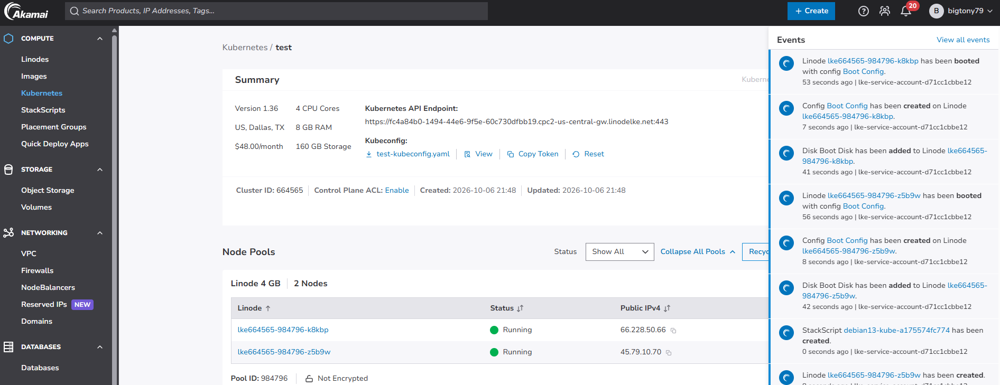
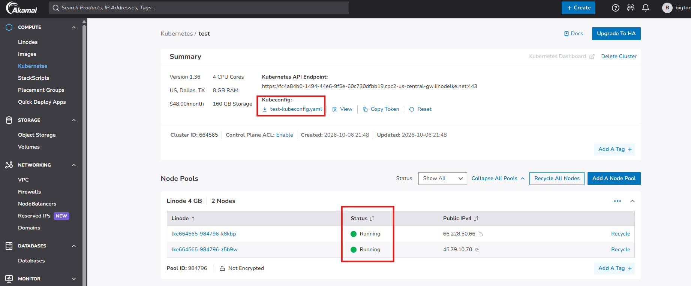

# Install a stateful service (MongoDB) on Kubernetes using Helm

## Overview

This project demonstrates how to deploy a highly available MongoDB database on a managed Kubernetes cluster using Helm. The deployment uses a MongoDB Replica Set running as a StatefulSet, with persistent storage dynamically provisioned through Linode Kubernetes Engine (LKE).

In addition to the database layer, Mongo Express is deployed as a web-based administration interface, allowing database management directly from a browser. An NGINX Ingress Controller is configured to provide external access to the application.

This project highlights several key Kubernetes concepts, including: 
- Managed Kubernetes clusters with Linode Kubernetes Engine (LKE)
- Stateful applications using Kubernetes StatefulSets
- Persistent volumes and dynamic storage provisioning
- Helm chart deployment and customization
- MongoDB replica set architecture
- Secrets management
- Kubernetes Services and DNS
- Ingress Controllers and external access
- High availability and data persistence testing

## Technologies used:
* Kubernetes
* Helm
* MongoDB
* Mongo Express
* Linode Kubernetes Engine (LKE)
* Linode Block Storage
* NGINX Ingress controller
* kubectl

## Pre-requisites
Before starting this project, ensure the following tools and accounts are available:
* Linode account
* Kubernetes cluster administrator permissions
* kubectl installed locally
* Helm installed locally
* Basic understanding of Kubernetes concepts:
    - Pods
    - Services
    - StatefulSets
    - Persistent Volumes (PVs)
    - Persistent Volume Claims (PVCs)
    - Ingress
* Basic understanding of MongoDB

## Project Description:
* Create a managed Kubernetes cluster using Linode Kubernetes Engine (LKE)
* Deploy a MongoDB Replica Set using the Bitnami Helm chart
* Configure three MongoDB replicas using StatefulSets
* Provision persistent storage using Linode Block Storage
* Deploy Mongo Express as a web-based administration interface
* Configure NGINX Ingress for external access
* Validate MongoDB data persistence by scaling StatefulSet replicas down and back up
* Clean up all Kubernetes and cloud resources

### MongoDB Helm Configuration

The MongoDB deployment uses a custom Helm values file to configure a MongoDB Replica Set with persistent storage. The configuration specifies three MongoDB replicas and uses Linode's Storage Class for dynamic volume provisioning. helm-mongodb.yaml

### Mongo Express Configuration

Mongo Express is deployed as a Kubernetes Deployment with two replicas and connects to the MongoDB StatefulSet through the Kubernetes headless service endpoint. Authentication credentials are retrieved from Kubernetes Secrets created during the MongoDB Helm deployment. helm_mongo_express.yaml  

## Steps

### 1. Create a Linode Kubernetes Engine (LKE) Cluster
 
Create a new Kubernetes cluster using Linode Kubernetes Engine (LKE).
 
During cluster creation:
 
- Select the desired Kubernetes version.
- Choose a data center region.
- Configure the worker node pool size and instance type.
- Review the configuration and create the cluster.

In this project, the Kubernetes control plane is fully managed by Linode, allowing us to focus on deploying and managing applications.
 






### 2. Wait for the Cluster to Become Available
 
After provisioning begins, wait for the cluster status to change to **Running**.

The Kubernetes worker nodes must be fully initialized before applications can be deployed.

Verify the cluster status in the Linode Cloud Manager.



### 3. Download the Kubeconfig File
 
Once the cluster is ready, download the cluster's **kubeconfig** file from the LKE portal.
 
The kubeconfig file contains:
 
- Cluster endpoint information
- Authentication credentials
- Context configuration used by kubectl
 
Save the file locally.



### 4. Configure kubectl to Connect to the LKE Cluster
 
Before configuring the kubeconfig file, verify whether kubectl is currently connected to a cluster.
 
```bash
kubectl get nodes
```
 
If no cluster is configured, an error similar to the following may be displayed:
 
```text
The connection to the server localhost:8080 was refused
```
 
INSERT SCREENSHOTS
 
Configure kubectl to use the downloaded kubeconfig file:
 
```bash
export KUBECONFIG=lke-cluster.yaml
```
 
Verify connectivity:
 
```bash
kubectl get nodes
```
 
Expected output:
 
```text
NAME STATUS ROLES
lke-node-1 Ready
lke-node-2 Ready
lke-node-3 Ready
```
 
INSERT SCREENSHOTS

### 5. Deploy MongoDB StatefulSet Using Helm
 
#### a. Install Helm
 
Install Helm using the package manager appropriate for your operating system.
 
Example for Windows:
 
```bash
winget install Helm.Helm
```
 
Verify the installation:
 
```bash
helm version
```
 
INSERT SCREENSHOTS

#### b. Add the Bitnami Helm Repository
 
Add the Bitnami repository, which hosts the MongoDB Helm chart.
 
```bash
helm repo add bitnami https://charts.bitnami.com/bitnami
```
 
Update local repository metadata:
 
```bash
helm repo update
```
 
INSERT SCREENSHOTS

#### c. Search for the MongoDB Chart
 
Confirm that the MongoDB chart is available.
 
```bash
helm search repo bitnami/mongodb
```

Insert screenshot

#### d. Configure MongoDB Deployment Parameters
 
Review the custom values file:
 
```text
helm-mongodb.yaml
```

This file contains deployment-specific settings including:
 
- Replica Set architecture
- Number of MongoDB replicas
- Persistent storage configuration
- Root password configuration

#### e. Install the MongoDB Helm Chart
 
Deploy MongoDB using the custom values file.
 
```bash
helm install mongodb \
--values helm-mongodb.yaml \
bitnami/mongodb
```
 
Verify that the release was successfully installed:
 
```bash
helm ls
```

#### f. Verify the Deployment
 
Check the status of the deployed resources.
 
```bash
kubectl get pods
kubectl get svc
kubectl get pvc
kubectl get secret
```
 
Verify that:
 
- Three MongoDB Pods are running.
- Persistent Volume Claims are bound.
- Kubernetes Secrets have been generated.
- Services have been created.
 
INSERT SCREENSHOTS

#### g. Verify Persistent Storage
 
Navigate to the LKE portal and verify that persistent storage volumes were automatically provisioned.
 
Because the deployment uses:
 
```yaml
storageClass: linode-block-storage
```
 
Kubernetes dynamically creates a dedicated volume for each MongoDB replica.
 
Expected result:
 
```text
mongodb-0 -> PVC -> Volume
mongodb-1 -> PVC -> Volume
mongodb-2 -> PVC -> Volume
```
 
INSERT SCREENSHOTS

### 6. Deploy Mongo Express and Configure External Access
 
#### a. Deploy Mongo Express
 
Deploy Mongo Express, a web-based administration tool for MongoDB.
 
```bash
kubectl apply -f helm_mongo_express.yaml
```
 
Verify deployment:
 
```bash
kubectl get deployments
kubectl get pods
kubectl get svc
```
 
INSERT SCREENSHOTS

#### b. Install the NGINX Ingress Controller
 
Install the NGINX Ingress Controller using Helm.
 
```bash
helm install nginx-ingress \
oci://ghcr.io/nginxinc/charts/nginx-ingress \
--set controller.replicaCount=2
```
 
Verify installation:
 
```bash
kubectl get pods -A
kubectl get svc -A
```
 
INSERT SCREENSHOTS

#### c. Configure an Ingress Resource
 
After the Ingress Controller is installed, a Linode NodeBalancer will be automatically created.
 
Retrieve the external hostname from the LKE portal.
 
INSERT SCREENSHOTS
 
Update the hostname field in:
 
```text
helm_ingress.yaml
```
 
Example:
 
```yaml
rules:
- host: mongoexpress.example.com
```

Apply the ingress configuration:
 
```bash
kubectl apply -f helm_ingress.yaml
```
 
Verify the Ingress resource:
 
```bash
kubectl get ingress
```
 
INSERT SCREENSHOTS

### 7. Access Mongo Express
 
Open a browser and navigate to the hostname associated with the NodeBalancer.
 
Example:
 
```text
http://mongoexpress.example.com
```
 
Verify that:
 
- Mongo Express loads successfully.
- Authentication works correctly.
- The application can connect to the MongoDB Replica Set.
 
INSERT SCREENSHOTS

### 8. Validate Data Persistence and Resiliency
 
#### a. Create a Test Database
 
Using Mongo Express:
 
1. Create a new database.
2. Create a test collection.

INSERT SCREENSHOTs

#### b. Scale Down the MongoDB Replica Set
 
Scale all MongoDB Pods down to zero replicas.
 
```bash
kubectl scale --replicas=0 statefulset/mongodb
```
 
Verify:
 
```bash
kubectl get pods
```
 
INSERT SCREENSHOTS

#### c. Scale the Replica Set Back Up
 
Restore the deployment.
 
```bash
kubectl scale --replicas=3 statefulset/mongodb
```
 
Verify:
 
```bash
kubectl get pods
```
 
Wait until all Pods return to the **Running** state.
 
INSERT SCREENSHOTS

#### d. Validate Data Persistence
 
Reconnect to Mongo Express and verify that:
 
- The test database still exists.
- The collection remains intact.
 
This confirms that the data persisted on the Persistent Volumes even though the Pods were destroyed and recreated.
 
INSERT SCREENSHOTS

### 9. Clean Up Resources
 
#### a. Remove Helm Releases
 
List currently installed Helm releases:
 
```bash
helm ls
```
 
Uninstall MongoDB:
 
```bash
helm uninstall mongodb
```
 
Uninstall the NGINX Ingress Controller:
 
```bash
helm uninstall nginx-ingress
```
 
INSERT SCREENSHOTS
 
#### b. Delete the LKE Cluster
 
Navigate to the LKE portal and delete the Kubernetes cluster.
 
This removes:
 
- Worker nodes
- Control plane resources
- Kubernetes networking components
 
INSERT SCREENSHOTS
 
#### c. Remove Unattached Persistent Volumes
 
Deleting the cluster does not automatically delete associated storage volumes.
 
Review the list of remaining volumes and remove any unattached volumes to avoid unnecessary charges.
 
INSERT SCREENSHOTS

## Learning Outcomes

By completing this project, you will learn how to:

* Deploy stateful workloads in Kubernetes using StatefulSets
* Install and manage applications with Helm
* Customize Helm chart deployments using values files
* Configure MongoDB Replica Sets on Kubernetes
* Implement data persistence using Persistent Volumes and Persistent Volume Claims
* Use cloud-native storage through Kubernetes Storage Classes
* Expose applications using Services and Ingress Controllers
* Manage secrets within Kubernetes
* Understand StatefulSet pod identity and ordered scaling
* Validate application resiliency and data persistence
* Operate a managed Kubernetes platform in the cloud
* Troubleshoot Kubernetes networking, storage, and application deployments


