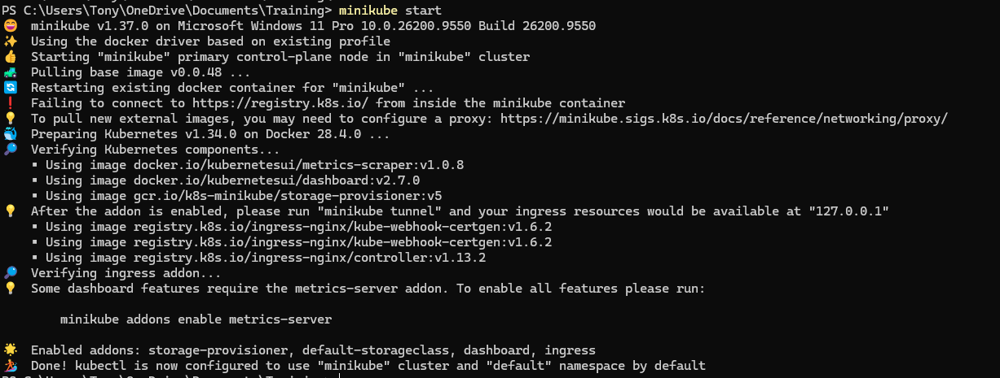
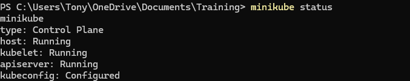
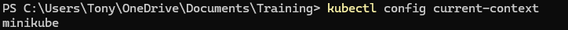
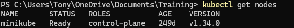
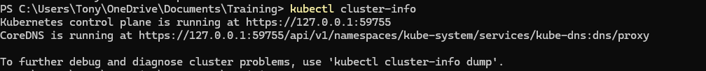
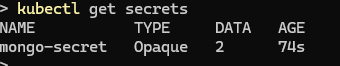
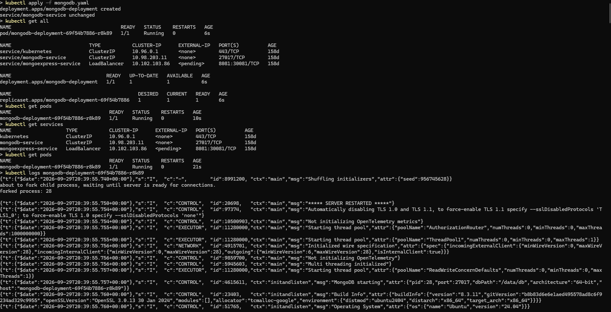
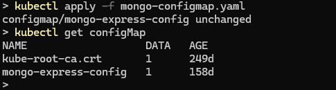
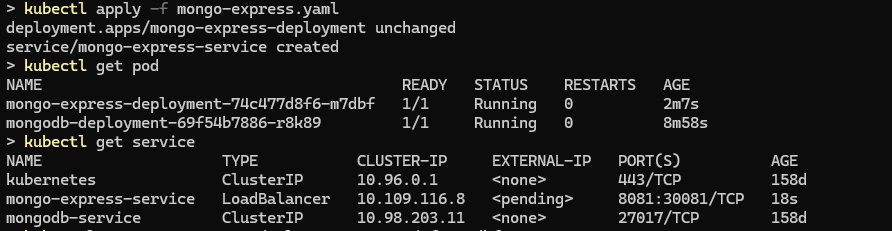
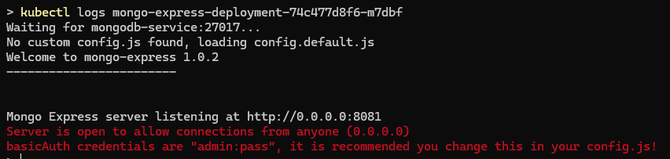

# Kubernetes Demo Project: MongoDB & Mongo Express Deployment

## Overview

This self-study project demonstrates how to deploy MongoDB and Mongo Express on a local Kubernetes cluster using Minikube. The focus is on Kubernetes fundamentals, including deployments, services, secrets, and config maps, as well as secure configuration management and inter-pod communication.

## Technologies Used
* Kubernetes (Minikube)
* Docker
* MongoDB
* Mongo Express

## Project Objectives

* Provision a local Kubernetes cluster with Minikube
* Deploy MongoDB as a backend database
* Secure database credentials using Kubernetes Secrets
* Centralize configuration using ConfigMaps
* Deploy Mongo Express as a web-based UI for MongoDB
* Expose Mongo Express externally using a Kubernetes Service

## Architecture Summary

**MongoDB**

* Deployed as a Kubernetes Deployment
* Credentials stored securely in a Kubernetes Secret
* Internal access provided via a ClusterIP Service

**Mongo Express**

* Deployed as a separate Kubernetes Deployment
* Configuration provided via a ConfigMap
* Accesses MongoDB using the internal ClusterIP Service
* Exposed externally using a LoadBalancer (NodePort) Service

## Steps

### 1. Initialize Local Kubernetes Cluster 

* Start a local Kubernetes cluster using Minikube.

```
    minikube start
```



* Check for status

```
    minikube status    
```


* Check for current context, nodes and cluster info

```
    kubectl config current-context
```



```
    kubectl get nodes
```



```
    kubectl cluster-info
```



### 2. Secure MongoDB Credentials

* Create a Kubernetes Secret to store MongoDB root credentials.
* Credentials are base64-encoded as required by Kubernetes.  
Here is an example on how to generate base64 encoded values:
```
    echo -n 'username' | base64
    echo -n 'password' | base64
```
* Ensured the secret was created before deploying MongoDB.
```
    kubectl apply -f mongo-secret.yaml
```
* Verify that you can see the secret
```
    kubectl get secrets
```



### 3. Deploy MongoDB

* Create a MongoDB Deployment referencing credentials from the Secret.
* Add a ClusterIP Service to expose MongoDB internally within the cluster.
* Verify pod health and deployment status using kubectl.
```
    kubectl apply -f mongodb.yaml
    kubectl get all
    kubectl get pods
    kubectl get services
    kubectl get pod
    kubectl logs <mongodb-pod-name>
```



### 4. Centralize Configuration with ConfigMap

* Create a ConfigMap to store the MongoDB connection string.
* Use the internal service name (mongodb-service:27017) for service discovery.
```
    kubectl apply -f mongo-express-config.yaml
    kubectl get configMap
```



### 5. Deploy Mongo Express**  

* Create a Mongo Express Deployment referencing:
    - MongoDB credentials via Secret
    - MongoDB connection URL via ConfigMap
* Verify successful startup using pod logs.
```
    kubectl apply -f mongo-express.yaml
    kubectl get pod
    kubectl get service
    kubectl logs <mongo-express-pod-name>
```




### 6. Expose Mongo Express Externally

* Configure a LoadBalancer (NodePort) Service under **mongo-express.yaml** deployment configuration file.
```
    ---
    apiVersion: v1
    kind: Service
    metadata:
      name: mongoexpress-service
    spec:
      selector:
        app: mongoexpress
      type: LoadBalancer  
      ports:
        - protocol: TCP
          port: 8081
          targetPort: 8081
          nodePort: 30081
```

* Use Minikube’s service tunnel to access Mongo Express via a browser.
```
    kubectl apply -f mongo-express.yaml
    kubectl get service
```


### 7. Accessing the Application

Once deployed, Mongo Express can be accessed locally using:
```
minikube service mongoexpress-service
```
This opens the Mongo Express web interface in the browser, allowing secure interaction with the MongoDB instance running inside the Kubernetes cluster.

## Key Learnings

* Kubernetes resource dependencies (Secrets before Deployments)
* Secure credential handling using Kubernetes Secrets
* Service-based communication between pods
* Difference between ClusterIP and LoadBalancer service types
* Deploying and exposing applications in a local Kubernetes environment